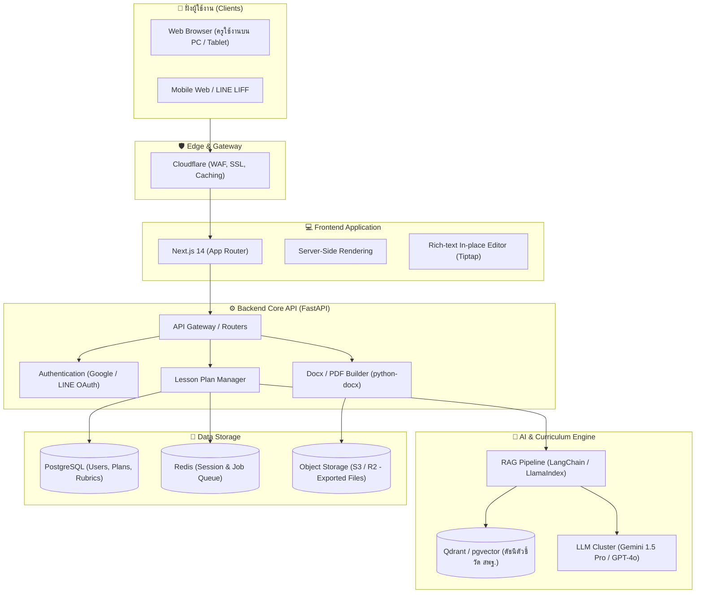

# สถาปัตยกรรมระบบจริง (Production Architecture) - "ครูช่วยร่าง"

เอกสารนี้อธิบายรายละเอียดทางเทคนิคของแพลตฟอร์ม **ครูช่วยร่าง (KruChuai)** สำหรับการพัฒนาเป็นระบบ Production ที่พร้อมรองรับผู้ใช้งานจริง

---

## 1. ภาพรวมสถาปัตยกรรม (System Architecture Diagram)

---

## 2. องค์ประกอบหลักของระบบ (Core Components)

### 2.1 Frontend Layer (Next.js 14)
- **Framework:** Next.js (TypeScript, React 18+)
- **Styling:** Tailwind CSS + Radix UI / shadcn/ui
- **State Management:** Zustand / TanStack Query
- **Editor:** Tiptap Headless Editor ที่จัดแต่งสไตล์เอกสารราชการ

### 2.2 Backend Layer (Python FastAPI)
- **High Concurrency & Async:** รองรับการเชื่อมต่อ Streaming Response จาก LLM
- **Authentication:** JWT Token พร้อมการเชื่อมต่อ OAuth กับ Google for Education
- **Task Queue:** Celery / ARQ ผ่าน Redis สำหรับงานที่ใช้เวลาประมวลผล เช่น การสร้างไฟล์ Docx ขนาดใหญ่หรือการ Export PDF

### 2.3 AI & RAG Engine
- **Curriculum Indexing:** รวบรวมตัวชี้วัดและสาระการเรียนรู้แกนกลางตามหลักสูตรแกนกลางการศึกษาขั้นพื้นฐาน พุทธศักราช 2551 (ฉบับปรับปรุง 2560)
- **Embedding Model:** `text-embedding-3-small` หรือ Open-source Thai Embedding (เช่น WangchanBERTa)
- **Context Injection:** ดึงเฉพาะตัวชี้วัดที่เกี่ยวข้อง 2-3 ข้อส่งต่อให้ LLM เพื่อป้องกันการสร้างรหัสตัวชี้วัดปลอม

### 2.4 Data & Storage Layer
- **PostgreSQL 16:** เก็บข้อมูลโครงสร้างความสัมพันธ์ (User Profiles, Lesson Plans, Worksheets)
- **Object Storage (Cloudflare R2 / AWS S3):** สำหรับจัดเก็บไฟล์เอกสารพร้อมดาวน์โหลด

---

## 3. มาตรการความปลอดภัยและจริยธรรมข้อมูล (Security & PDPA)

1. **ไม่เก็บข้อมูลส่วนบุคคลของนักเรียน (Zero Student PII):** ระบบต้องการเพียงจำนวนนักเรียนโดยประมาณเท่านั้น ไม่มีฟิลด์ชื่อ สกุล หรือเลขประจำตัวนักเรียน
2. **Data Retention & Encryption:** ข้อมูลแผนการสอนถูกเข้ารหัส (AES-256) และสามารถลบได้ตลอดเวลาตามคำร้องขอของครู
3. **Rate Limiting & Cost Guard:** ควบคุมโควตาการเรียกใช้งาน AI ต่อบัญชีครู เพื่อป้องกันการใช้ทรัพยากรเกินขนาด
