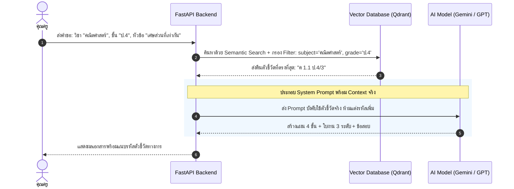

# ข้อกำหนดข้อมูลหลักสูตรแกนกลาง & กระบวนการ RAG (Curriculum Data & RAG Specification)

หัวใจสำคัญที่ทำให้ระบบ "ครูช่วยร่าง" แตกต่างจาก AI ทั่วไป คือการไม่สร้างรหัสตัวชี้วัดปลอม (No Hallucination on Curriculum) ผ่านการสืบค้นข้อมูลจริงจากหลักสูตรแกนกลางการศึกษาขั้นพื้นฐาน พ.ศ. 2551 (ฉบับปรับปรุง 2560)

---

## 1. โครงสร้างชุดข้อมูลตัวชี้วัด (Curriculum Schema)

แต่ละรายการตัวชี้วัดจะถูกจัดเก็บในรูปแบบ JSON สำหรับนำไปทำ Embedding:

```json
{
  "standard_code": "ค 1.1 ป.4/3",
  "subject_group": "คณิตศาสตร์",
  "strand": "สาระที่ 1 จำนวนและพีชคณิต",
  "standard_title": "มาตรฐาน ค 1.1 เข้าใจความหลากหลายของการแสดงจำนวน ระบบจำนวน การดำเนินการของจำนวน...",
  "grade_level": "ป.4",
  "learning_objective": "ระบุ เขียน และอ่านเศษส่วน จำนวนคละ แสดงปริมาณของสิ่งต่าง ๆ และแสดงสิ่งต่าง ๆ ตามเศษส่วน จำนวนคละที่กำหนด",
  "keywords": ["เศษส่วน", "เศษส่วนที่เท่ากัน", "จำนวนคละ", "เศษส่วนอย่างต่ำ"]
}
```

---

## 2. ขั้นตอนการทำงานของ RAG Engine



---

## 3. ตัวอย่างการเก็บไฟล์ชุดข้อมูลตัวชี้วัด (Sample Seed Data)

ไฟล์ตั้งต้นถูกจัดเก็บไว้ใน `backend/data/curriculum/seed_standards.json` เพื่อใช้เป็นฐานข้อมูลนำร่อง
