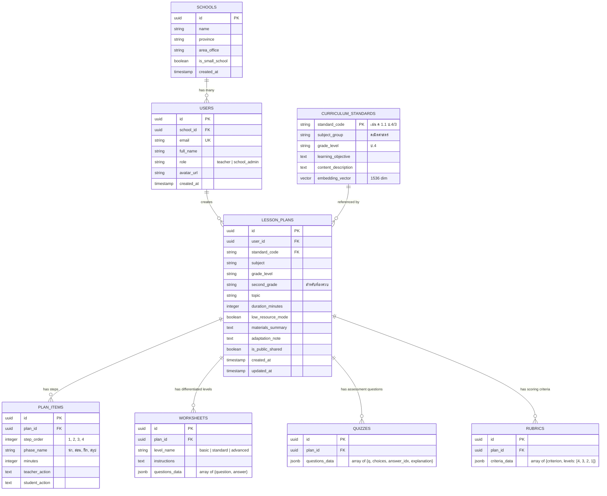

# ข้อกำหนดฐานข้อมูลและ Data Model (Database Schema)

ระบบใช้งาน **PostgreSQL 16** ร่วมกับส่วนขยาย **pgvector**

---

## 1. ผังความสัมพันธ์ของข้อมูล (Entity Relationship Diagram)



---

## 2. ตัวอย่าง SQL DDL (Table Definitions)

```sql
-- เปิดส่วนขยาย UUID และ Vector
CREATE EXTENSION IF NOT EXISTS "uuid-ossp";
CREATE EXTENSION IF NOT EXISTS "vector";

-- ตารางมาตรฐานตัวชี้วัด สพฐ.
CREATE TABLE curriculum_standards (
    standard_code VARCHAR(50) PRIMARY KEY,
    subject_group VARCHAR(100) NOT NULL,
    grade_level VARCHAR(20) NOT NULL,
    learning_objective TEXT NOT NULL,
    content_description TEXT,
    embedding vector(1536)
);

-- ตารางแผนการสอน
CREATE TABLE lesson_plans (
    id UUID PRIMARY KEY DEFAULT uuid_generate_v4(),
    user_id UUID NOT NULL,
    standard_code VARCHAR(50) REFERENCES curriculum_standards(standard_code),
    subject VARCHAR(100) NOT NULL,
    grade_level VARCHAR(20) NOT NULL,
    second_grade VARCHAR(20),
    topic VARCHAR(255) NOT NULL,
    duration_minutes INTEGER DEFAULT 50,
    low_resource_mode BOOLEAN DEFAULT TRUE,
    adaptation_note TEXT,
    is_public_shared BOOLEAN DEFAULT FALSE,
    created_at TIMESTAMP WITH TIME ZONE DEFAULT NOW(),
    updated_at TIMESTAMP WITH TIME ZONE DEFAULT NOW()
);
```
