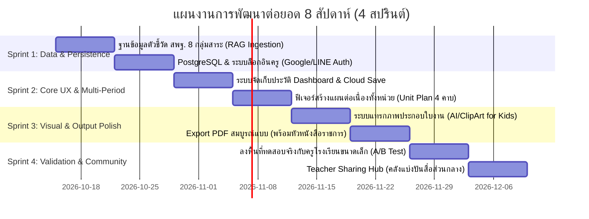

# แผนปฏิบัติการพัฒนาต่อยอดเชิงลึก (Next-Phase Action Plan)
**แพลตฟอร์ม "ครูช่วยร่าง" (KruChuai): ยกระดับจาก Working MVP สู่ Pilot & Scalable Platform**

---

## 1. ภาพรวมการแบ่งสปรินต์พัฒนา (4-Sprint Roadmap)

แผนงานนี้ถูกออกแบบเป็น **4 สปรินต์ (ระยะเวลาสปรินต์ละ 2 สัปดาห์ รวม 8 สัปดาห์)** เพื่อผลักดันโปรเจกต์จากระดับ Functional MVP ไปสู่ระดับที่มีผู้ใช้จริงและพร้อมส่งแข่งขัน/ระดมทุนสนับสนุน:

---

## 2. รายละเอียดงานในแต่ละสปรินต์ (Actionable Backlog)

### 🏃‍♂️ Sprint 1: ขยายฐานข้อมูลหลักสูตร & ระบบบัญชีผู้ใช้ (สัปดาห์ที่ 1 - 2)
**เป้าหมาย:** ให้ครูมีบัญชีส่วนตัว และระบบรู้จักตัวชี้วัดทุกวิชาของ สพฐ. โดยไม่จำกัดแค่ตัวอย่าง 4 ข้อ
- [ ] **Task 1.1: National Curriculum Ingestion Script**
  - พัฒนา Python Script สกัดข้อมูลหลักสูตรแกนกลางการศึกษาขั้นพื้นฐาน พ.ศ. 2551 (ฉบับปรับปรุง 2560) จากเอกสารทางการของกระทรวงศึกษาธิการ
  - ครอบคลุม 8 กลุ่มสาระการเรียนรู้: คณิตศาสตร์, วิทยาศาสตร์และเทคโนโลยี, ภาษาไทย, ภาษาต่างประเทศ, สังคมศึกษาฯ, สุขศึกษาฯ, ศิลปะ, การงานอาชีพ (ระดับ ป.1 – ม.3) รวมกว่า 1,500+ ตัวชี้วัด
- [ ] **Task 1.2: Database Persistence & User Authentication**
  - ติดตั้ง PostgreSQL พร้อมส่วนขยาย `pgvector`
  - ทำระบบ Authentication ด้วย NextAuth.js หรือ Supabase Auth รองรับ **Google Workspace for Education** และ **LINE Login**
  - ผูกข้อมูลตาราง `users` เข้ากับ `lesson_plans`

---

### 🏃‍♂️ Sprint 2: ระบบจัดการแผนการสอน & แผนระยะยาว (สัปดาห์ที่ 3 - 4)
**เป้าหมาย:** ครูบันทึกงานไว้เปิดดูย้อนหลังได้ และสามารถวางแผนการสอนต่อเนื่องหลายคาบได้
- [ ] **Task 2.1: Teacher Personal Dashboard**
  - หน้าจัดการเอกสารส่วนตัว: แสดงรายการแผนการสอนทั้งหมดที่เคยทำ แยกตามภาคเรียน วิชา และระดับชั้น
  - ระบบค้นหาเอกสารเก่า, ทำสำเนา (Duplicate) เพื่อนำไปปรับใช้กับปีการศึกษาถัดไป
- [ ] **Task 2.2: Multi-Period Unit Plan Generator (แผนการสอนทั้งหน่วย)**
  - เพิ่มทางเลือกระหว่าง "แผนรายคาบ (Single Lesson: 50 นาที)" กับ "แผนหน่วยการเรียนรู้ (Unit Plan: 3–6 คาบ)"
  - ให้ AI ร่างโครงร่างความต่อเนื่องของกิจกรรมตลอดสัปดาห์ พร้อมจัดทำแบบทดสอบวัดผลรวมท้ายหน่วย

---

### 🏃‍♂️ Sprint 3: ยกระดับใบงานเด็กเล็ก & เอกสารพร้อมส่ง ผอ. (สัปดาห์ที่ 5 - 6)
**เป้าหมาย:** ใบงานสำหรับเด็กมีรูปภาพประกอบ และเอกสาร Word/PDF จัดฟอร์แมตสมบูรณ์แบบ
- [ ] **Task 3.1: Visual Worksheet Component (รูปภาพสำหรับเด็ก ป.1 - ป.3)**
  - บูรณาการคลัง ClipArt ทางการศึกษาแบบ Open-source หรือ Image Generation API
  - ระบบแทรกภาพอัตโนมัติลงในใบงานระดับพื้นฐาน (เช่น ภาพสัตว์, ผลไม้, เรขาคณิต, นาฬิกา) เพื่อช่วยนักเรียนที่มีปัญหาการอ่าน
- [ ] **Task 3.2: Export to PDF & Word Template Customizer**
  - เพิ่มการตั้งค่าหัวหนังสือ: ใส่ตราโรงเรียน, ชื่อผู้อำนวยการ, ชื่อครูผู้สอน, กลุ่มสาระ
  - ระบบแปลงเป็น `.pdf` (Vector format) สวยงาม คมชัด พร้อมพิมพ์ออกเครื่องพิมพ์ได้ทันที

---

### 🏃‍♂️ Sprint 4: ลงพื้นที่ทดสอบจริง & คลังแบ่งปันสื่อ (สัปดาห์ที่ 7 - 8)
**เป้าหมาย:** ได้ข้อมูลสถิติตัวเลขเชิงประจักษ์ (Empirical Evidence) และเปิดให้ครูทั่วประเทศแลกเปลี่ยนแผนกันได้
- [ ] **Task 4.1: Field Pilot Testing (ทดสอบกับครูโรงเรียนขนาดเล็ก 3-5 คน)**
  - ทำการทดสอบ A/B Testing ตามคู่มือ [USER_TESTING_GUIDE.md](file:///d:/KruChuai/docs/USER_TESTING_GUIDE.md)
  - วัดผลเปรียบเทียบเวลา: ก่อนใช้ vs หลังใช้ระบบ
  - ประเมินความพึงพอใจและสัดส่วนความถูกต้องทางวิชาการ
- [ ] **Task 4.2: Teacher Sharing Hub (คลังแผนการสอนส่วนกลาง)**
  - ให้ครูกด "แชร์สู่สาธารณะ (Share to Community)"
  - มีระบบค้นหาแผนการสอนดีเด่น พร้อมปุ่ม "Clone to My Account" ให้ครูท่านอื่นนำไปใช้ต่อได้ในคลิกเดียว

---

## 3. สรุปความต้องการด้านทรัพยากร (Resources & Tech Stack)

| องค์ประกอบ | เทคโนโลยีที่แนะนำ | เหตุผล / ค่าใช้จ่าย |
|---|---|---|
| **Database & Auth** | Supabase (PostgreSQL + Auth) | ฟรีสำหรับ Free Tier, มี pgvector ในตัว |
| **Hosting & Deploy** | Vercel (Frontend) + Render / Railway (Backend) | ใช้งานง่าย ไม่ต้องดูแล Server เอง |
| **AI LLM Engine** | Google Gemini 1.5 Flash API | รองรับภาษาไทยได้ดีเยี่ยม, มี Free Tier เพียงพอสำหรับการนำร่อง |
| **เอกสารราชการ** | Python `python-docx` + `reportlab` | ควบคุม Layout ตารางและฟอนต์สารบรรณได้ละเอียด 100% |

---

## 4. ตัวชี้วัดความสำเร็จของโปรเจกต์ (Key Performance Indicators)

1. **⏱️ Time Reduction:** ลดเวลาในการเตรียมแผน ใบงาน และข้อสอบลงได้อย่างน้อย **70 - 80%** (เช่น จาก 3 ชั่วโมง เหลือไม่เกิน 30 นาที)
2. **🎯 Curriculum Accuracy:** อัตราความถูกต้องตรงตามตัวชี้วัด สพฐ. สูงกว่า **95%** (ประเมินโดยครูผู้สอนจริง)
3. **🏫 Multi-grade Usability:** ครูโรงเรียนขนาดเล็กสอนควบชั้นประเมินความสามารถในการใช้งานจริงเฉลี่ย **4.5 ขึ้นไป (จาก 5.0)**
